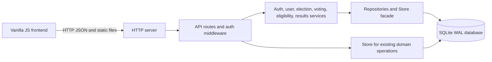

# System and Developer Guide

## Overview

ElectraVote is a C++17 modular monolith with a hand-written HTTP/1.1 server,
JSON API, vanilla JavaScript single-page frontend, SQLite persistence, and
libsodium password hashing/randomness. Route handlers in `src/api.cpp` form the
HTTP controller layer. Business rules live in services; database SQL and
transactional persistence live in `Store` and SQLite.



## Request and API routing

- `src/http.cpp` parses HTTP requests, limits request headers/body, applies
  socket timeouts, dispatches method/path routes, serves static assets, and
  returns common security/cache headers.
- `src/api.cpp` registers `/api/` routes. It derives users from the
  `ov_session` cookie through `AuthService`; role information from request
  bodies is not trusted.
- Unmatched non-API paths go through static file serving with a path traversal
  check and SPA fallback. `/api/` misses return JSON 404.
- The built-in server is HTTP only. `OV_BIND_ADDRESS` defaults to `127.0.0.1`;
  an HTTPS proxy should connect locally.

## Services, repositories, and persistence

Service and repository headers/implementations are under `src/services/` and
`src/repositories/`. Current modules include authentication, users,
organizations, elections, election lifecycle, candidates, eligibility, voting,
audit, and results. Some legacy persistence operations still use `Store`
directly from API handlers; the project is being improved incrementally rather
than rewritten.

`src/db.*` wraps SQLite, bound parameters, schema migrations, and transaction
helpers. `src/store.*` owns schema and most SQL. The default database path is
`<OV_DATA_DIR>/openvote.db`; SQLite WAL mode may create `-wal` and `-shm`
sidecars. Do not delete these sidecars while the database is running.

Core records include `users`, `sessions`, `organizations`, `elections`,
`candidates`, `eligibility`, `participation`, `ballots`, `tally_runs`,
`tally_results`, and `audit_events`.

## Authentication and sessions

Passwords are hashed with libsodium's Argon2id implementation. Sessions are
random tokens whose hashes are stored in SQLite. The browser receives an
HttpOnly, SameSite=Lax cookie; `OV_SECURE_COOKIES=1` adds Secure when HTTPS is
terminated at a trusted proxy. Password changes and disabling accounts revoke
sessions. Login throttling is in process and does not coordinate across
instances or survive restarts.

## Election lifecycle and voting

Lifecycle state is enforced server-side. Draft configuration/candidates/
eligibility are editable only while Draft. The usual path is Draft → Open →
Closed → Published → Archived; draft archiving is also supported. Publication
uses the existing Store transaction to calculate candidate totals, check
ballot/participation consistency, persist tally rows, and publish atomically.

Ballot submission validates role, election state/time, organization,
eligibility, candidate membership, and prior participation. The Store writes
the ballot, participation record, and vote audit event in one transaction.
Participation and choice are stored separately, but this design does not
provide cryptographic anonymity.

```mermaid
sequenceDiagram
  participant V as Voter browser
  participant A as API/VotingService
  participant S as Store/SQLite
  V->>A: POST election vote (candidateId)
  A->>A: Check session, role, scope, eligibility, lifecycle
  A->>S: Record ballot + participation + audit
  S->>S: BEGIN IMMEDIATE; enforce uniqueness; COMMIT
  A-->>V: Non-revealing receipt
```

## Results and audit

Results reads use the latest persisted tally; they do not calculate or overwrite
results. Public access follows publication/visibility settings. Authorized
administrators/observers may read permitted results; live totals require their
configured setting and existing permissions. CSV uses the persisted aggregate
results and does not contain voter identities or individual choices.

Audit records store timestamp, actor, action, election target (when applicable),
and sanitized detail. Vote event detail omits candidate choice. Platform admins
can read platform-wide logs; organization administrators and observers are
scoped to their organization's election-linked entries. Audit data is not
cryptographically tamper-evident.

## Frontend interaction

`web/index.html`, `web/app.js`, `web/style.css`, and `web/assets/` implement the
existing single-page UI. The frontend calls JSON endpoints with the session
cookie, but all authorization is repeated in C++. It provides voter, admin,
observer, election detail, ballot review/confirmation, results, and CSV links.
Do not treat hidden buttons or route navigation as access control.

## Project map

| Path | Purpose |
| --- | --- |
| `src/main.cpp` | Configuration, crypto/database initialization, bootstrap admin, server startup |
| `src/http.*` | HTTP server, routing, static serving, cookies, socket lifecycle |
| `src/api.*` | API endpoint registration and response mapping |
| `src/db.*` | SQLite connection, migration, transaction adapter |
| `src/store.*` | Schema, SQL persistence, transaction boundaries |
| `src/models.h` | Domain records |
| `src/services/` | C++ business rules |
| `src/repositories/` | Service-to-Store persistence interfaces |
| `web/` | Existing HTML/CSS/JavaScript UI and assets |
| `tests/` | Service and HTTP integration tests |
| `Makefile` | Build and test commands |

## Build and test

Requirements are Linux/WSL, `g++` with C++17, `make`, bash/curl for smoke
tests, and the runtime library files configured by the Makefile:
`libsodium.so.23` and `libsqlite3.so.0`.

```sh
make -j2
bash -n tests/smoke.sh
make test
git diff --check
```

The service and smoke tests use isolated temporary SQLite databases. Do not
point tests at the runtime database. For route and environment details, see
[`API.md`](../API.md) and [`DEPLOYMENT_GUIDE.md`](DEPLOYMENT_GUIDE.md).

## Current limitations

This is an educational/demo application. It has no independent tally
verification, no specified tie resolution, no cryptographic anonymity, no
durable distributed rate limiting, no built-in TLS, and no certification.
Production use requires independent security, privacy, legal, accessibility,
operational, and jurisdiction-specific review.
